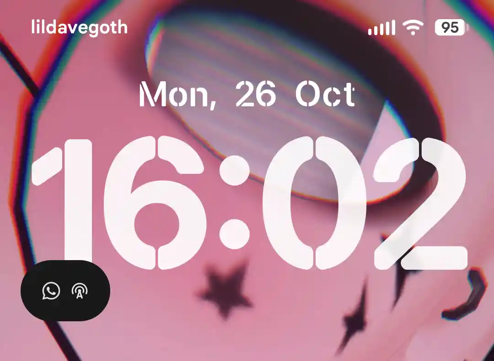

# [BaikalOS 16.2 Dev](https://sourceforge.net/projects/baikalos/files/surya/BaikalOS-16-surya-DEV-20260618-01.zip/download) →
Android 16 by svasiliev22 with Stock Kernel
- display of Minimized Notification in Lockscreen is kinda buggy

- Search Bar in app drawer is kinda buggy if you set it to the bottom and not top (default)

- ibisPaint X storage permission is kinda buggy or something (can be fixed itself after restar)
